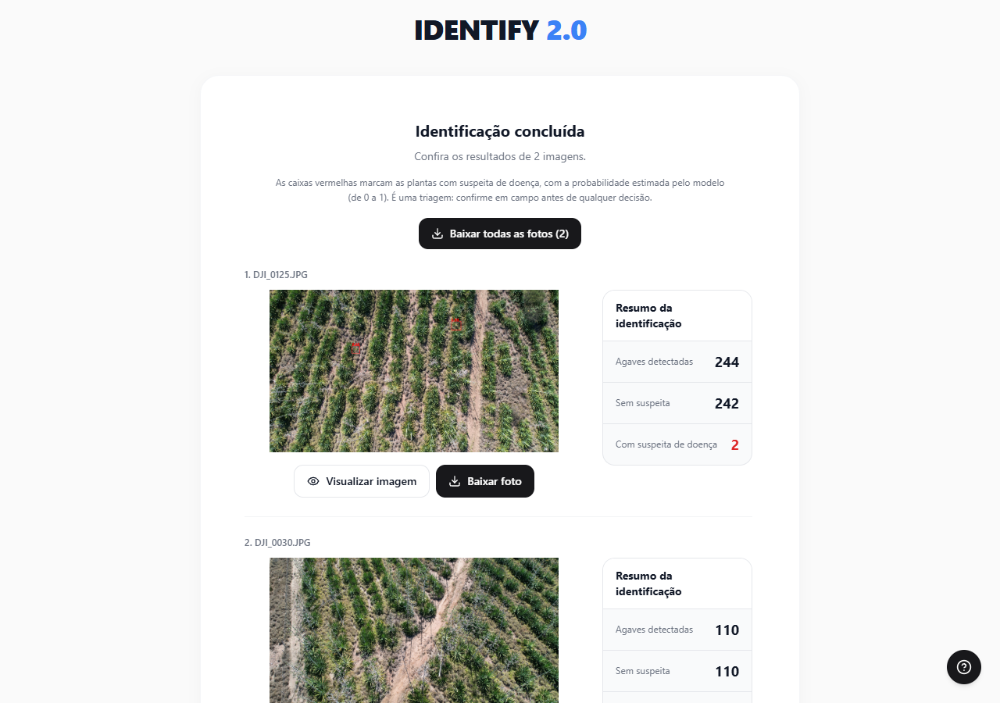

# IDENTIFY 2.0

**Detecção de agaves e triagem de suspeita de doença em fotos aéreas de drone.**

O usuário envia as fotos da plantação pelo navegador. O sistema conta as agaves
de cada foto e marca em vermelho as plantas com aparência de doente, com a
probabilidade estimada. O resultado é uma **triagem**: aponta onde o agrônomo
deve olhar primeiro em campo, sem substituir a inspeção.



Este repositório reúne o sistema completo, frontend e backend com os modelos de
IA, pronto para rodar com **Docker Compose**.

---

## Sumário

- [Início rápido](#início-rápido)
- [Documentação](#documentação)
- [Como funciona](#como-funciona)
- [Tecnologias](#tecnologias)
- [Estrutura do repositório](#estrutura-do-repositório)
- [Modelos e desempenho](#modelos-e-desempenho)
- [Limitações conhecidas](#limitações-conhecidas)
- [Melhorias e novas funcionalidades](#melhorias-e-novas-funcionalidades)
- [Origem do código](#origem-do-código)

---

## Início rápido

Pré-requisito: [Docker Desktop](https://www.docker.com/products/docker-desktop/)
instalado e **aberto**, com pelo menos ~3 GB de RAM livres para os containers.

```bash
git clone https://github.com/f-lrz/Identify2.0_docker.git
cd Identify2.0_docker
docker compose up -d --build
```

O primeiro build baixa cerca de 1 GB (PyTorch) e leva alguns minutos. Quando
`docker compose ps` mostrar o backend como `healthy`, abra
**http://localhost:8080**.

| Comando | Para quê |
|---|---|
| `docker compose up -d` | ligar (sem reconstruir) |
| `docker compose down` | desligar |
| `docker compose logs -f` | acompanhar os logs |

Detalhes de operação, configuração e solução de problemas:
[`docs/operacao-docker.md`](docs/operacao-docker.md).

---

## Documentação

| Documento | Para quem | Conteúdo |
|---|---|---|
| [Manual do usuário](docs/manual-do-usuario.md) | Quem vai **usar** o site | Passo a passo com capturas de tela, como ler o resultado, avisos, erros e boas práticas de foto |
| [Arquitetura (C4)](docs/arquitetura-c4.md) | Desenvolvedores, avaliadores | Diagramas C4 de contexto, containers e componentes, e as decisões de arquitetura |
| [Casos de uso](docs/casos-de-uso.md) | Analistas, avaliadores | Diagrama de casos de uso, atores e a descrição de cada caso |
| [Operação com Docker](docs/operacao-docker.md) | Quem **instala e mantém** | Comandos, portas, configuração, atualização e solução de problemas |
| [Contrato da API](backend/API.md) | Quem integra com o backend | Campos de `POST /api/analyze`, erros, tempos e avisos |
| [Ficha do detector](backend/models/MODELO.md) | Quem avalia o modelo | Dados, métricas e limitações do detector de agaves |
| [Ficha do classificador de saúde](backend/models/MODELO_SAUDE.md) | Quem avalia o modelo | Dados, métricas, convenção das plantas secas e limitações |

O manual do usuário e o guia de operação também estão em **Word e PDF**, para
imprimir ou enviar: [`docs/exportados/`](docs/exportados/)
(`manual-do-usuario.docx/.pdf` e `operacao-docker.docx/.pdf`).

---

## Como funciona

```
foto do drone ─► 1. DETECÇÃO ──────────► 2. TRIAGEM DE SAÚDE ──────► resultado
 (5472x3078)     acha cada agave         para cada agave:            contagem +
                 (YOLOv8s, foto cortada  probabilidade de doença     suspeitas marcadas
                 em 45 pedaços)          (YOLOv8s-cls)               + JSON
```

O trabalho é dividido em **dois modelos**, de propósito: a doença é rara (cerca
de 1 planta a cada 100). Num modelo único que detectasse "agave doente" e
"agave sadia" ao mesmo tempo, a classe rara seria ignorada. Assim, o
**detector** só precisa achar agaves, e o **classificador** olha cada planta de
perto e só decide se ela parece doente.

Dois detalhes que fazem diferença no resultado:

- **A foto é analisada em pedaços (tiles).** Uma foto de drone tem 5472x3078
  pixels; reduzida de uma vez, cada agave viraria um ponto de ~24 px e
  desapareceria. O detector analisa 45 pedaços de 1024x1024 com sobreposição e
  depois junta os resultados, eliminando as repetições.
- **Plantas secas não contam como doentes.** Foi uma convenção definida no
  projeto e ensinada ao classificador.

Arquitetura completa em [`docs/arquitetura-c4.md`](docs/arquitetura-c4.md).

---

## Tecnologias

| Camada | Tecnologias |
|---|---|
| **Frontend** | React 19, Vite 8, Tailwind CSS (via CDN), lucide-react; servido por nginx 1.27 |
| **Backend** | Python 3.12, FastAPI, Uvicorn, OpenCV, NumPy |
| **IA** | Ultralytics YOLOv8 (detecção e classificação), PyTorch 2.6 (CPU) |
| **Infraestrutura** | Docker, Docker Compose (2 containers + rede interna) |

---

## Estrutura do repositório

```
Identify2.0_docker/
├── README.md                    este arquivo
├── docker-compose.yml           liga frontend e backend
├── docs/
│   ├── manual-do-usuario.md     manual de uso, com capturas de tela
│   ├── arquitetura-c4.md        diagramas C4 e decisões de arquitetura
│   ├── casos-de-uso.md          diagrama e descrição dos casos de uso
│   ├── operacao-docker.md       guia de operação
│   ├── diagramas/               fontes Mermaid (.mmd) + PNG e SVG
│   └── img/                     capturas de tela
├── backend/                     API de Visão (FastAPI)
│   ├── Dockerfile
│   ├── API.md                   contrato da API
│   ├── app/
│   │   ├── main.py              aplicação e startup
│   │   ├── api/routes.py        POST /api/analyze
│   │   └── services/
│   │       ├── vision_service.py           orquestra a análise
│   │       └── agave_detector/             os modelos em ação
│   │           ├── detector.py             detecção por tiles + NMS
│   │           ├── tiling.py               grade de tiles
│   │           └── saude.py                triagem de saúde
│   └── models/
│       ├── best.pt              pesos do detector
│       ├── classificador_saude.pt  pesos do classificador
│       ├── MODELO.md            ficha do detector
│       └── MODELO_SAUDE.md      ficha do classificador
└── frontend/                    Aplicação Web (React)
    ├── Dockerfile               build com Node, servido por nginx
    ├── nginx.conf               serve o site e repassa /api ao backend
    └── src/components/          telas: envio, progresso, resultado, erro
```

---

## Modelos e desempenho

| | Detector de agaves | Classificador de saúde |
|---|---|---|
| **Arquitetura** | YOLOv8s (detecção, 1 classe) | YOLOv8s-cls (doente / sadia) |
| **Treino** | 42 fotos, 14.568 agaves rotuladas à mão | 248 plantas doentes e 2.480 sadias, de 107 fotos de 3 voos |
| **Desempenho** | Acha 80,6% das agaves; 76,8% das caixas estão corretas; erro de **~5% na contagem** | Acha ~81% das doentes; ~81% das suspeitas são doentes; AUC 0,981 |
| **Plantas secas** | — | 3 de 33 secas de teste marcadas como suspeitas (antes da correção eram 29) |
| **Tempo (CPU)** | ~11 s por foto | ~1 s por foto |

Os números foram medidos em amostras pequenas e numa única plantação. Os
detalhes e as ressalvas estão nas fichas
[`MODELO.md`](backend/models/MODELO.md) e
[`MODELO_SAUDE.md`](backend/models/MODELO_SAUDE.md).

---

## Limitações conhecidas

- **Triagem, não diagnóstico.** Os rótulos de treino vieram de julgamento
  visual nas fotos aéreas, sem confirmação em laboratório.
- **Um sítio, um drone.** Em outra plantação, outro solo ou outra câmera, o
  desempenho tende a cair sem novo treino.
- **Exige a foto original, vertical e na altura de voo padrão.** Foto reduzida
  ou tirada baixo demais gera aviso e resultado pouco confiável.
- **CPU apenas:** de ~15 a 20 s por foto no Docker, e uma análise por vez.
- **Sem histórico:** nada é salvo; fechar a página perde o resultado.
- **Estilo da tela via internet:** sem internet, a página abre sem formatação.

---

## Melhorias e novas funcionalidades

Propostas para a continuidade do projeto, por área. As de **curto prazo** são
mudanças pequenas e de baixo risco.

### Modelos de IA

| Proposta | Benefício | Prazo |
|---|---|---|
| **Validar o recall em campo**: comparar as suspeitas com a inspeção de um agrônomo num talhão inteiro | Medir quantas doentes o sistema realmente deixa passar | Curto |
| **Ciclo de realimentação**: o agrônomo confirma ou descarta cada suspeita na tela, e esses casos voltam para o treino | Melhora o modelo continuamente, com rótulos confirmados | Médio |
| **Mais dados e mais sítios**: voos em outras épocas, plantações e câmeras | Modelo que generaliza para novos clientes | Médio |
| **Retreinar o detector com fotos de voo baixo e inclinadas** | Remove as principais causas de aviso | Médio |
| **Classes adicionais**: planta seca/morta, falha de plantio, outras doenças | Relatório mais completo do talhão | Longo |
| **Inferência em GPU** (imagem CUDA) | De ~15 s para menos de 1 s por foto | Médio |

### Funcionalidades para o usuário

| Proposta | Benefício | Prazo |
|---|---|---|
| **Tela de revisão das suspeitas**: recorte ampliado de cada planta suspeita, com botões "confirmar" e "descartar" | Revisão muito mais rápida que procurar caixas na foto inteira | Curto |
| **Baixar tudo em um único .zip** | Um download só, em vez de vários | Curto |
| **Relatório em PDF/CSV** por voo: contagem, taxa de suspeita e lista de plantas | Documento para o produtor e para o histórico | Médio |
| **Mapa georreferenciado**: usar o GPS das fotos (EXIF) para localizar as suspeitas num mapa do talhão | O agrônomo vai direto à planta em campo | Médio |
| **Histórico de análises**, com banco de dados e armazenamento das fotos | Acompanhar a evolução da doença entre voos | Médio |
| **Contas de usuário e permissões** | Uso por várias fazendas e equipes | Longo |
| **Análise de voo inteiro / ortomosaico** | Visão do talhão completo, sem plantas contadas em dobro entre fotos | Longo |
| **Aplicativo para celular / uso offline em campo** | Conferência das suspeitas no próprio talhão | Longo |

### Engenharia e infraestrutura

| Proposta | Benefício | Prazo |
|---|---|---|
| **Compilar o Tailwind no build** (em vez do CDN) | Funciona sem internet e fica mais estável | Curto |
| **Fila de processamento** (ex.: Celery/RQ) com progresso por foto | Muitos usuários e lotes grandes sem estourar o tempo limite | Médio |
| **Testes automatizados e CI** (GitHub Actions: lint, testes, build das imagens) | Evita regressões a cada mudança | Curto |
| **HTTPS, domínio e CORS restrito** ao endereço do frontend | Pronto para uso fora da rede local | Médio |
| **Monitoramento e logs centralizados** | Identificar erros e lentidão em produção | Médio |
| **Publicar as imagens num registro** (Docker Hub / GHCR) | Instalação sem build local | Curto |
| **Versionar os pesos dos modelos fora do Git** (Git LFS ou armazenamento de artefatos) | Repositório leve, com histórico dos modelos | Curto |

---

## Origem do código

O código de `backend/` e `frontend/` é uma cópia dos repositórios de
desenvolvimento, tirada das branches `feature/triagem-saude`:

| Pasta | Repositório de origem |
|---|---|
| `backend/` | `identify2.0-backend` |
| `frontend/` | `identify2.0-frontend` (pasta `identify-app/`) |
| `backend/models/*.pt` | treinados no repositório `agave-yolo` (pipeline de dados, treino e avaliação dos modelos) |

Como atualizar esta cópia: ver
[`docs/operacao-docker.md`](docs/operacao-docker.md#o-que-tem-nas-pastas).
