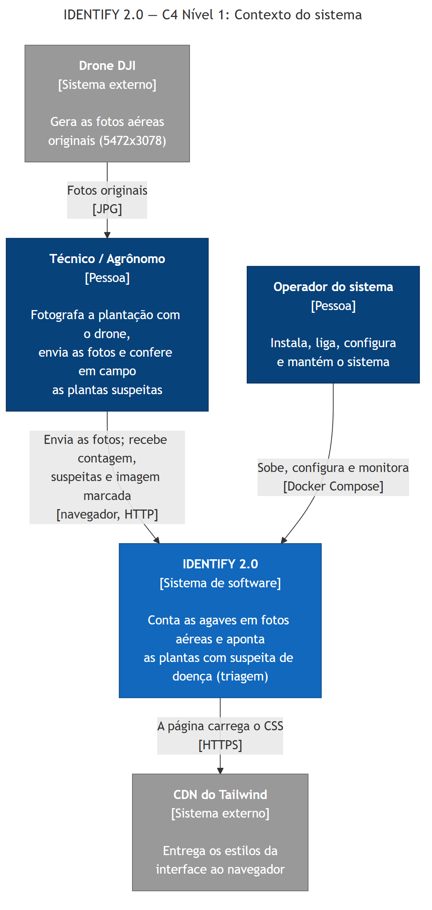
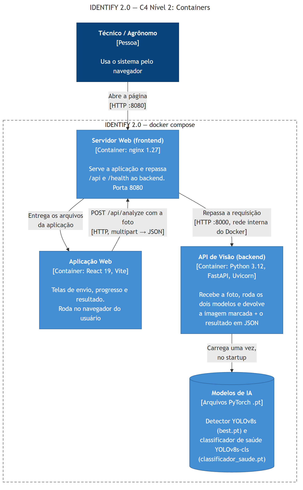
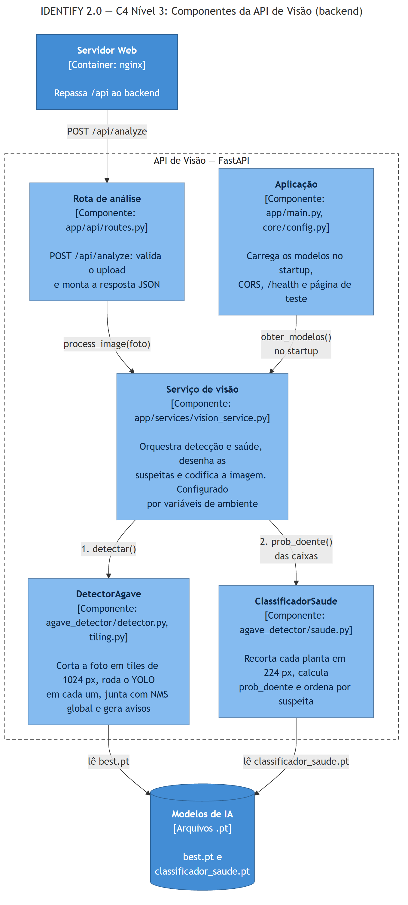
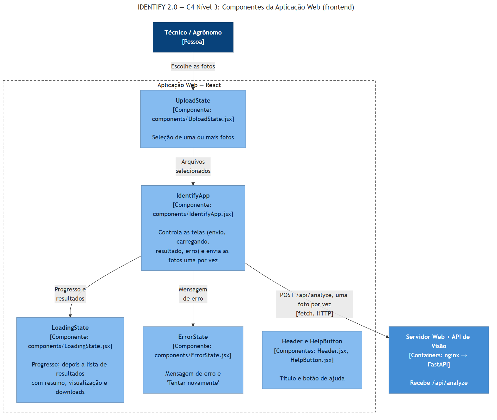

# Arquitetura — modelo C4

A arquitetura do IDENTIFY 2.0 descrita no [modelo C4](https://c4model.com/), do
mais geral para o mais detalhado:

1. [Contexto](#nível-1--contexto): o sistema e quem o usa.
2. [Containers](#nível-2--containers): as partes que rodam separadamente.
3. [Componentes](#nível-3--componentes): o que há dentro do backend e do
   frontend.

Os diagramas usam as cores do C4: **azul-escuro** para pessoas, **azul** para o
sistema, os containers e os componentes (do mais escuro ao mais claro, conforme
o nível) e **cinza** para sistemas externos. Cada elemento traz seu tipo entre
colchetes, e a linha **tracejada** marca a fronteira do sistema ou do container.

Os arquivos-fonte (`.mmd`, Mermaid) estão em [`diagramas/`](diagramas/), com as
versões PNG e SVG. Para editar, abra o `.mmd` em
[mermaid.live](https://mermaid.live) ou em qualquer editor com suporte a
Mermaid.

---

## Nível 1 — Contexto



| Elemento | Tipo | Papel |
|---|---|---|
| Técnico / Agrônomo | Pessoa | Envia as fotos do drone e confere em campo as plantas suspeitas |
| Operador do sistema | Pessoa | Instala, liga e configura o sistema (Docker Compose) |
| **IDENTIFY 2.0** | Sistema | Conta as agaves e faz a triagem de saúde das fotos aéreas |
| Drone DJI | Sistema externo | Origem das fotos (5472x3078, vista de cima) |
| CDN do Tailwind | Sistema externo | Fornece os estilos da interface. É a única dependência de internet |

O drone **não se conecta** ao sistema: o técnico copia as fotos do cartão e as
envia pelo navegador.

---

## Nível 2 — Containers



| Container | Tecnologia | Responsabilidade | Onde |
|---|---|---|---|
| **Aplicação Web** | React 19, Vite 8 | Telas de envio, progresso e resultado; envia as fotos uma por vez | Roda no navegador do usuário |
| **Servidor Web** | nginx 1.27 | Serve os arquivos da aplicação e repassa `/api/*` e `/health` ao backend | Container `frontend`, porta **8080** |
| **API de Visão** | Python 3.12, FastAPI, Uvicorn, Ultralytics, PyTorch (CPU) | Recebe a foto, roda os dois modelos, desenha as suspeitas e devolve imagem + JSON | Container `backend`, porta 8000 (rede interna) |
| **Modelos de IA** | Arquivos PyTorch `.pt` | `best.pt` (detector YOLOv8s, 1 classe) e `classificador_saude.pt` (YOLOv8s-cls, doente/sadia) | Dentro da imagem do backend |

### Decisões de arquitetura

| Decisão | Motivo |
|---|---|
| **Frontend e backend em containers separados** | Tamanhos e ciclos de mudança muito diferentes: o backend tem ~2,6 GB (PyTorch + modelos) e o frontend ~90 MB. Mudar a tela reconstrói só o front |
| **nginx repassa a API (proxy reverso)** | Página e API no mesmo endereço: sem problemas de CORS, e o sistema funciona quando acessado de outro computador da rede |
| **Uma foto por requisição, enviadas em sequência** | A análise leva ~15 a 20 s e ocupa todos os núcleos da CPU. Enviar em paralelo só faria as requisições esperarem e estourarem o tempo limite |
| **Modelos carregados uma vez, no startup** | Carregar a cada requisição somaria segundos a cada foto. O frontend só sobe quando o backend está `healthy`, ou seja, com os modelos já carregados |
| **Sem banco de dados** | O sistema não guarda fotos nem resultados: cada análise é independente. Persistência é uma das melhorias futuras (ver [README](../README.md#melhorias-e-novas-funcionalidades)) |
| **Inferência em CPU** | Funciona em qualquer servidor, sem placa de vídeo. GPU reduziria o tempo para menos de 1 s por foto, mas exige outra imagem e hardware dedicado |

---

## Nível 3 — Componentes

### API de Visão (backend)



| Componente | Arquivo | Responsabilidade |
|---|---|---|
| Aplicação | `app/main.py`, `app/core/config.py` | Cria a API, carrega os modelos no startup, configura o CORS, `/health` e a página de teste |
| Rota de análise | `app/api/routes.py` | `POST /api/analyze`: valida o arquivo, chama o serviço e monta a resposta JSON |
| Serviço de visão | `app/services/vision_service.py` | Orquestra detecção e saúde, desenha as suspeitas e codifica a imagem em base64. Lê a configuração das variáveis de ambiente. Roda a inferência fora do *event loop*, para o servidor continuar respondendo |
| DetectorAgave | `agave_detector/detector.py`, `tiling.py` | Corta a foto em tiles de 1024 px com 40% de sobreposição, roda o YOLO em cada tile, descarta pedaços de planta na borda, junta tudo com NMS global e gera os avisos (foto reduzida, voo baixo) |
| ClassificadorSaude | `agave_detector/saude.py` | Recorta cada planta (caixa + 15% de margem, 224x224), calcula `prob_doente` e ordena da mais suspeita para a menos |

**Fluxo de uma análise:** rota → serviço → `detectar()` (≈11 s) →
`prob_doente()` (≈1 s) → desenho das suspeitas → JSON com a imagem em base64.

### Aplicação Web (frontend)



| Componente | Arquivo | Responsabilidade |
|---|---|---|
| IdentifyApp | `src/components/IdentifyApp.jsx` | Estado da tela (envio, carregando, resultado, erro), envio sequencial das fotos e cancelamento de uma análise anterior |
| UploadState | `src/components/UploadState.jsx` | Seleção de uma ou mais fotos, sem reduzir os arquivos |
| LoadingState | `src/components/LoadingState.jsx` | Progresso da análise e, depois, a lista de resultados: resumo, visualização ampliada, baixar uma ou todas |
| ErrorState | `src/components/ErrorState.jsx` | Mensagem de erro e botão *Tentar novamente* |
| Header, HelpButton | `src/components/Header.jsx`, `HelpButton.jsx` | Título e botão de ajuda |

---

## Contrato entre frontend e backend

`POST /api/analyze` (multipart, campo `file`, uma foto). Resposta resumida:

```json
{
  "filename": "DJI_0125.JPG",
  "image_data": "data:image/jpeg;base64,...",
  "total_agaves": 244,
  "doentes": 2,
  "sadias": 242,
  "taxa_doenca": 0.0082,
  "limiar_doente": 0.5,
  "saude_ativa": true,
  "avisos": [],
  "plantas": [
    {"x1": 3441, "y1": 596, "x2": 3623, "y2": 763, "conf": 0.5549,
     "prob_doente": 0.9998, "saude": "doente"}
  ]
}
```

O contrato completo, com todos os campos, erros e tempos, está em
[`backend/API.md`](../backend/API.md).
