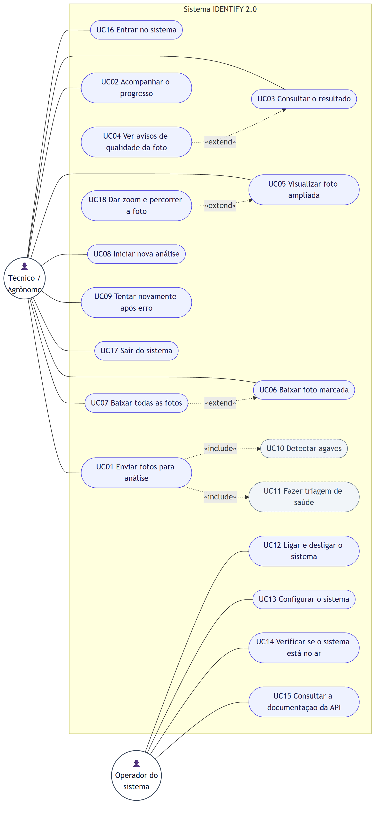

# Casos de uso — IDENTIFY 2.0

Fonte editável: [`diagramas/casos-de-uso.mmd`](diagramas/casos-de-uso.mmd)
(Mermaid). Versão vetorial: [`casos-de-uso.svg`](diagramas/casos-de-uso.svg).

**Leitura do diagrama:**

- **Linha cheia:** o ator participa do caso de uso.
- **«include»:** o caso de uso sempre executa o outro. Enviar fotos sempre
  dispara a detecção e a triagem.
- **«extend»:** o caso de uso acrescenta um comportamento opcional ao outro. Os
  avisos só aparecem em algumas fotos.
- **Casos com borda tracejada (UC10, UC11)** são executados pelo próprio
  sistema, sem interação direta do usuário.

## Atores

| Ator | Quem é | Como acessa |
|---|---|---|
| **Técnico / Agrônomo** | Quem fotografa a plantação, analisa as fotos e confere as suspeitas em campo | Navegador, porta 8080 |
| **Operador do sistema** | Quem instala, liga, configura e mantém o sistema | Terminal (Docker Compose) e navegador (`/health`, `/docs`) |

## Casos de uso do Técnico / Agrônomo

### UC16 — Entrar no sistema

| | |
|---|---|
| **Ator** | Técnico / Agrônomo |
| **Pré-condição** | Sistema no ar |
| **Fluxo principal** | 1. O usuário abre o endereço do sistema. 2. O sistema mostra a página de entrada. 3. O usuário informa usuário e senha e clica em *Entrar*. 4. O sistema mostra a tela de envio de fotos |
| **Fluxo alternativo** | 3a. Usuário ou senha incorretos: o sistema mostra *"Usuário ou senha incorretos."*, limpa a senha e continua na página de entrada |
| **Pós-condição** | Sessão aberta até o usuário sair (UC17) ou fechar a aba; recarregar a página não pede o login de novo |
| **Observação** | Login simples, combinado com o cliente: um único usuário fixo (`admin` / `admin`), sem cadastro, hash nem token. Serve para a tela de envio não abrir direto, e não protege a API |

### UC01 — Enviar fotos para análise

| | |
|---|---|
| **Ator** | Técnico / Agrônomo |
| **Pré-condição** | Usuário conectado (UC16) e com as fotos originais do drone |
| **Fluxo principal** | 1. O usuário clica em *Escolher imagens*. 2. Seleciona uma ou mais fotos. 3. O sistema envia as fotos ao servidor **uma por vez** e, para cada uma, executa UC10 e UC11. 4. Ao terminar a última, exibe o resultado (UC03) |
| **Fluxos alternativos** | 3a. Arquivo que não é imagem, vazio ou corrompido: o sistema interrompe e exibe a tela de erro (UC09). 3b. Servidor fora do ar: exibe erro de conexão (UC09) |
| **Pós-condição** | Resultado de todas as fotos exibido na tela; nada é armazenado no servidor |
| **Inclui** | UC10, UC11 |

### UC02 — Acompanhar o progresso

| | |
|---|---|
| **Ator** | Técnico / Agrônomo |
| **Fluxo** | Durante UC01, o sistema mostra *"Analisando imagem..."* e *"Processando imagem N de M"*, atualizados a cada foto |

### UC03 — Consultar o resultado

| | |
|---|---|
| **Ator** | Técnico / Agrônomo |
| **Pré-condição** | UC01 concluído sem erro |
| **Fluxo principal** | O sistema exibe *"Identificação concluída"* e a lista de fotos. Cada foto aparece com as suspeitas marcadas em vermelho (com a probabilidade) e o resumo: agaves detectadas, sem suspeita e com suspeita de doença |
| **Estendido por** | UC04 |

### UC04 — Ver avisos de qualidade da foto

| | |
|---|---|
| **Ator** | Técnico / Agrônomo |
| **Condição** | A foto chegou **reduzida** (menos de 3000 px no lado maior) ou foi tirada **baixo demais** (plantas com mais de ~400 px) |
| **Fluxo** | O sistema exibe, abaixo da foto, uma caixa amarela explicando o problema e o que fazer |
| **Estende** | UC03 |

### UC05 — Visualizar foto ampliada

| | |
|---|---|
| **Ator** | Técnico / Agrônomo |
| **Fluxo** | 1. O usuário clica na foto ou em *Visualizar imagem*. 2. O sistema abre a foto ampliada, ocupando a tela. 3. Opcionalmente, o usuário dá zoom (UC18) e usa a tela cheia. 4. O usuário fecha pelo X, pela tecla Esc ou clicando fora |
| **Estendido por** | UC18 |

### UC06 — Baixar foto marcada

| | |
|---|---|
| **Ator** | Técnico / Agrônomo |
| **Fluxo** | O usuário clica em *Baixar foto*; o navegador salva a foto em resolução original, com as suspeitas marcadas, com o nome `agaves_<arquivo original>` |

### UC07 — Baixar todas as fotos

| | |
|---|---|
| **Ator** | Técnico / Agrônomo |
| **Condição** | Mais de uma foto no resultado |
| **Fluxo** | O usuário clica em *Baixar todas as fotos*; o sistema dispara o download de cada foto, uma após a outra |
| **Estende** | UC06 |

### UC08 — Iniciar nova análise

| | |
|---|---|
| **Ator** | Técnico / Agrônomo |
| **Fluxo** | O usuário clica em *Enviar novas imagens*; o sistema descarta o resultado atual e volta à tela inicial |

### UC09 — Tentar novamente após erro

| | |
|---|---|
| **Ator** | Técnico / Agrônomo |
| **Pré-condição** | Tela *"Erro na análise"* exibida, com a mensagem do problema |
| **Fluxo** | O usuário clica em *Tentar novamente*; o sistema volta à tela inicial |

### UC17 — Sair do sistema

| | |
|---|---|
| **Ator** | Técnico / Agrônomo |
| **Pré-condição** | Usuário conectado (UC16) |
| **Fluxo** | O usuário clica em *Sair*; o sistema encerra a sessão, cancela uma análise em andamento e volta à página de entrada |

### UC18 — Dar zoom e percorrer a foto

| | |
|---|---|
| **Ator** | Técnico / Agrônomo |
| **Pré-condição** | Foto ampliada aberta (UC05), na janela ou em tela cheia |
| **Fluxo principal** | 1. O usuário rola a rodinha do mouse sobre um ponto; o sistema amplia (ou reduz) mantendo esse ponto sob o cursor, de 100% até 1000%. 2. Com zoom, o usuário arrasta a foto para percorrê-la; o sistema não deixa a foto sair da área de visualização. 3. O usuário volta ao tamanho normal pelo botão de seta circular, pela tecla 0 ou por duplo clique |
| **Fluxos alternativos** | 1a. Botões + e −, ou teclas + e −: zoom de 1,5x por vez, centrado. 1b. Duplo clique sem zoom: amplia 3x no ponto clicado. 1c. Tela de toque: pinça com dois dedos para o zoom e um dedo para arrastar |
| **Estende** | UC05 |

## Casos de uso internos do sistema

### UC10 — Detectar agaves

O servidor corta a foto em 45 pedaços de 1024x1024 com sobreposição, roda o
detector (YOLOv8s) em cada pedaço, junta os resultados descartando repetições
(NMS global) e devolve uma caixa por agave. Também verifica as condições de UC04.

### UC11 — Fazer triagem de saúde

Para cada caixa de UC10, o servidor recorta a planta, calcula a probabilidade de
doença com o classificador (YOLOv8s-cls), ordena as plantas da mais suspeita
para a menos e marca na foto as que têm probabilidade a partir de 0,50.

## Casos de uso do Operador do sistema

| Caso | Como |
|---|---|
| **UC12 — Ligar e desligar o sistema** | `docker compose up -d` / `docker compose down`, na pasta do repositório |
| **UC13 — Configurar o sistema** | Variáveis do backend no `docker-compose.yml` (limiar de suspeita, desenhar sadias, limiar do detector) e portas no `.env` |
| **UC14 — Verificar se o sistema está no ar** | `docker compose ps` (backend `healthy`) ou `http://localhost:8080/health` |
| **UC15 — Consultar a documentação da API** | `http://localhost:8000/docs`, acessível apenas na máquina do servidor |

Detalhes em [`operacao-docker.md`](operacao-docker.md).
