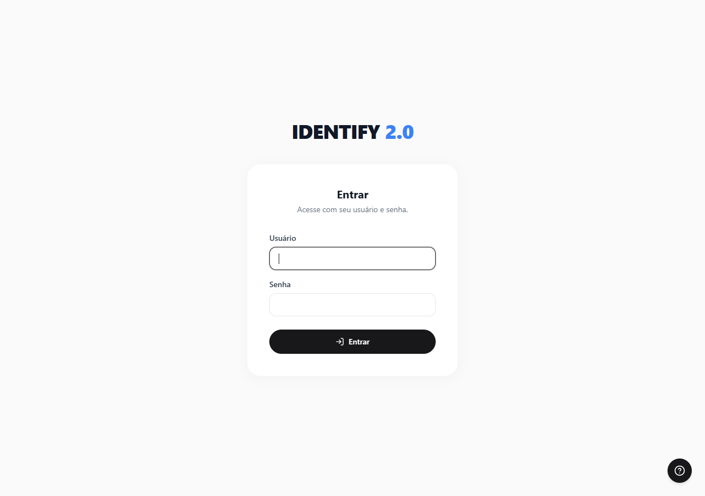
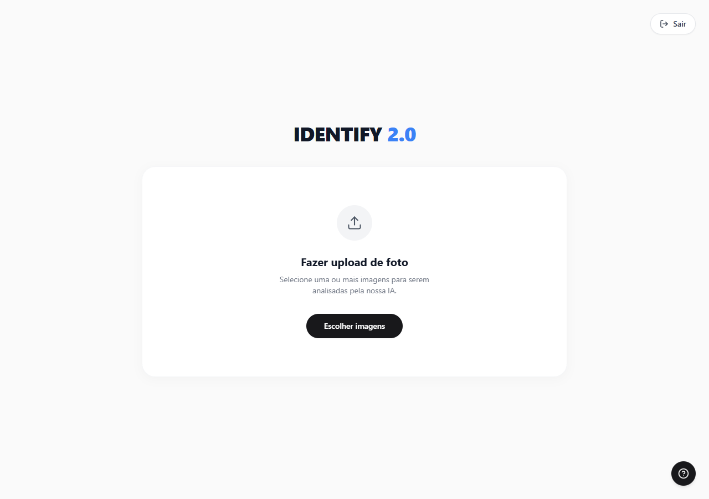
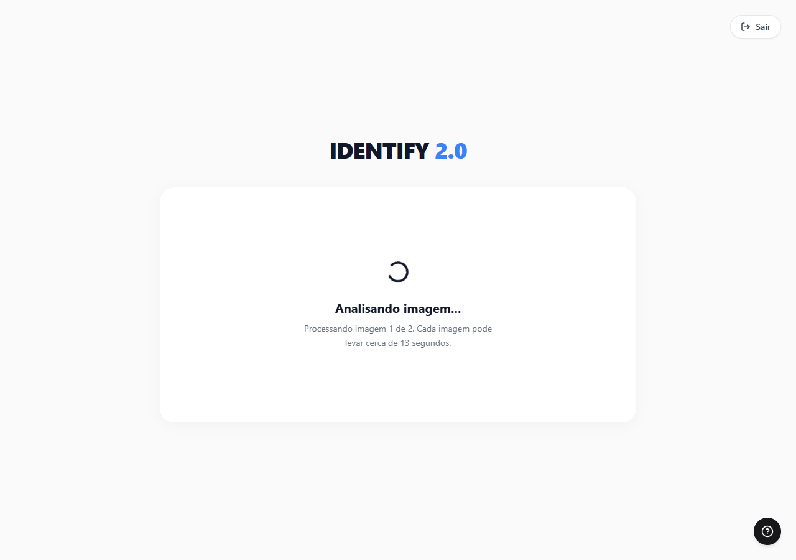
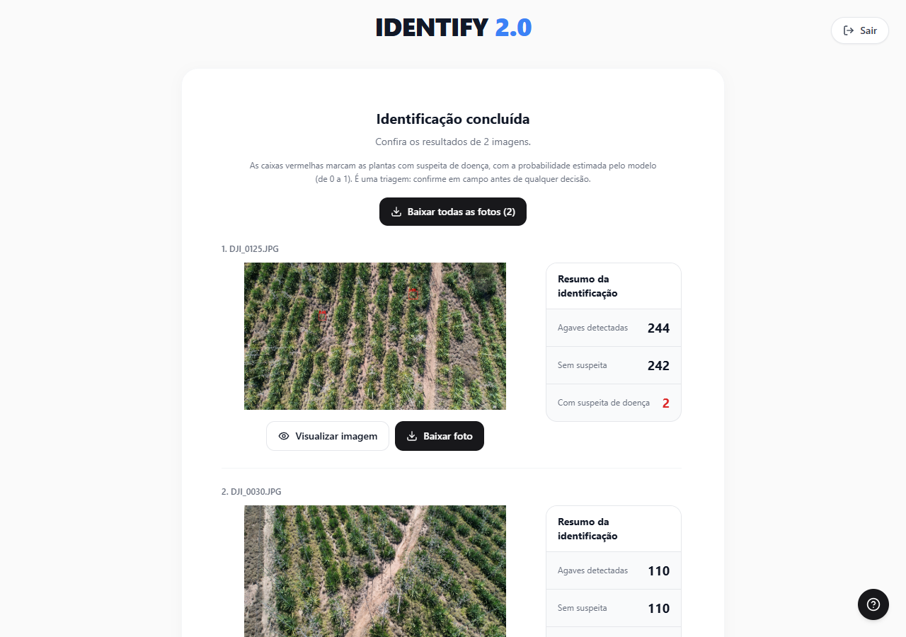
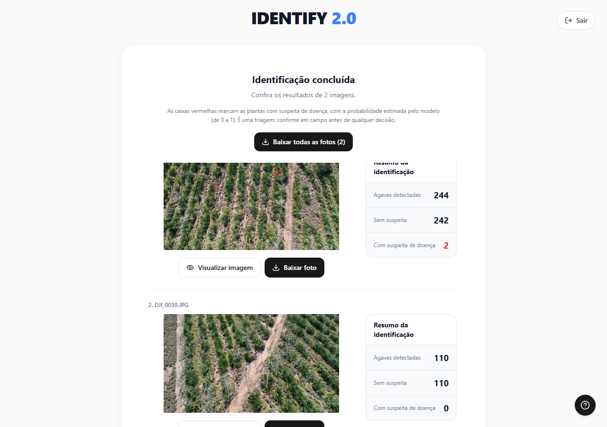
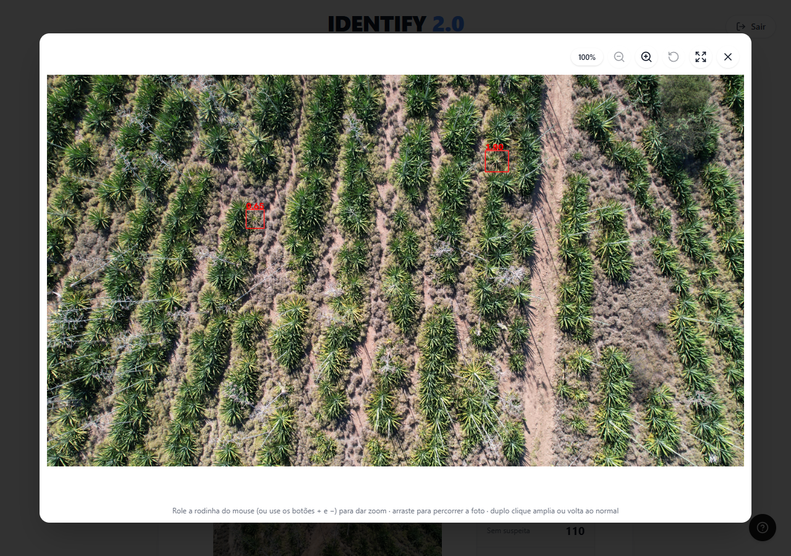
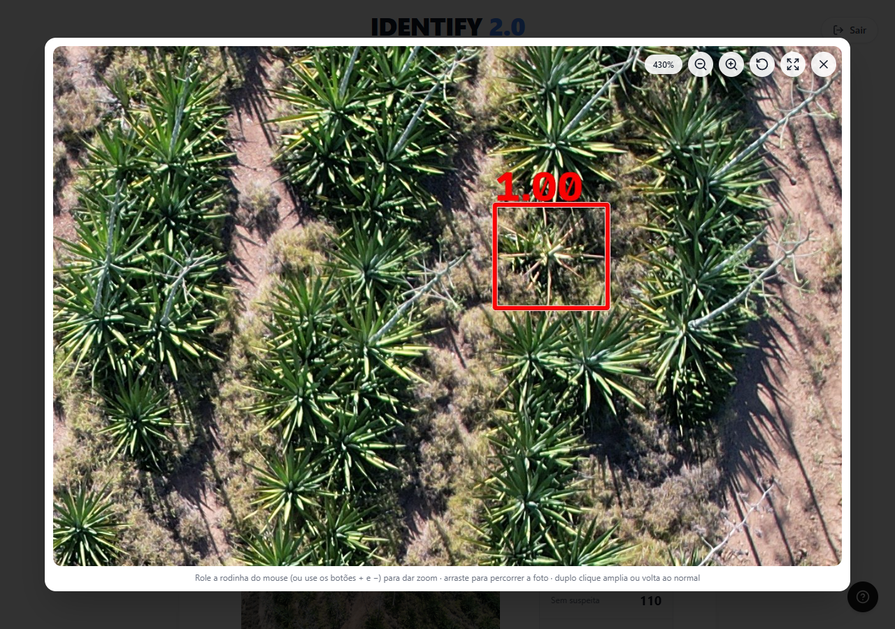
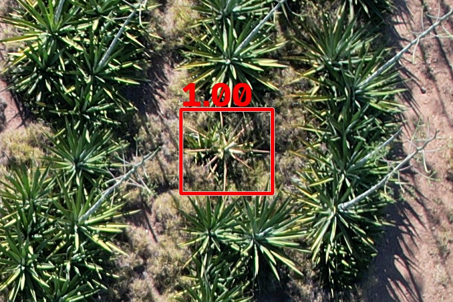
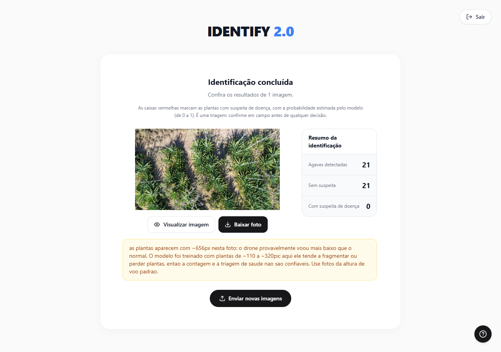
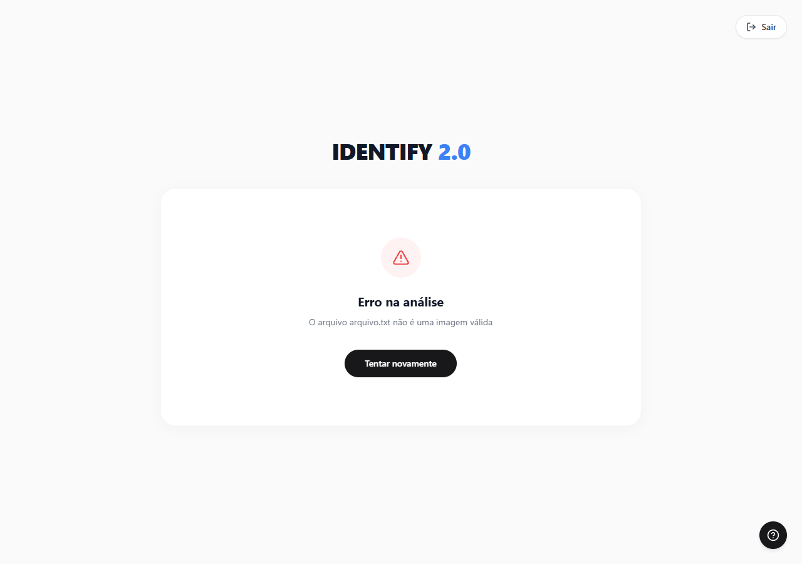

# Manual do usuário — IDENTIFY 2.0

Este manual é para quem vai usar o IDENTIFY 2.0 pela primeira vez. Não é
preciso saber nada de informática além de abrir um site e escolher arquivos no
computador.

## Sumário

1. [O que o IDENTIFY 2.0 faz](#1-o-que-o-identify-20-faz)
2. [Antes de começar](#2-antes-de-começar)
3. [Passo a passo](#3-passo-a-passo)
4. [Entendendo o resultado](#4-entendendo-o-resultado)
5. [Avisos e erros](#5-avisos-e-erros)
6. [Dicas para fotos melhores](#6-dicas-para-fotos-melhores)
7. [Perguntas frequentes](#7-perguntas-frequentes)
8. [Glossário](#8-glossário)

---

## 1. O que o IDENTIFY 2.0 faz

Você envia fotos da plantação tiradas com o drone, e o sistema:

- **conta as agaves** que aparecem em cada foto;
- **aponta as plantas com suspeita de doença**, marcando-as com uma caixa
  vermelha na foto.

> **Importante: o IDENTIFY 2.0 faz triagem, não diagnóstico.** Ele indica
> *onde vale a pena olhar primeiro*. A confirmação de que uma planta está doente
> é sempre feita por uma pessoa, em campo.

## 2. Antes de começar

Você vai precisar de:

| O que | Detalhe |
|---|---|
| **Um navegador** | Chrome, Edge ou Firefox, no computador |
| **O endereço do sistema** | Nesta instalação: **http://localhost:8080**. De outro computador da rede, quem administra o sistema informa o endereço (algo como `http://192.168.0.127:8080`) |
| **Usuário e senha** | Informados por quem administra o sistema. Nesta instalação: usuário **admin**, senha **admin** |
| **As fotos originais do drone** | Arquivos JPG do jeito que saíram do drone, sem cortar, reduzir nem passar por WhatsApp (ver [seção 6](#6-dicas-para-fotos-melhores)) |
| **Internet** | O visual da página é carregado da internet; sem ela, a página abre sem formatação |

## 3. Passo a passo

### Passo 1 — Abra o sistema e entre

Digite o endereço no navegador. Aparece a página de entrada:

1. Em **Usuário**, digite o usuário (nesta instalação: `admin`).
2. Em **Senha**, digite a senha (nesta instalação: `admin`).
3. Clique em **Entrar** ou aperte **Enter**.

Se aparecer *"Usuário ou senha incorretos."*, confira o que foi digitado
(letras maiúsculas e minúsculas contam) e tente de novo.

Depois de entrar, aparece a tela inicial. O botão **Sair**, no canto superior
direito, volta para a página de entrada:

Você continua conectado se atualizar a página (F5). Ao fechar a aba ou o
navegador, será preciso entrar de novo.

### Passo 2 — Escolha as fotos

1. Clique em **Escolher imagens**.
2. Na janela que abrir, vá até a pasta com as fotos do drone.
3. Selecione **uma ou várias** fotos. Para escolher várias, segure **Ctrl** e
   clique em cada uma, ou use **Ctrl + A** para selecionar todas da pasta.
4. Clique em **Abrir**.

A análise começa sozinha assim que você confirma.

### Passo 3 — Aguarde a análise

- Cada foto leva **cerca de 15 a 20 segundos**. Com 10 fotos, conte uns 3 minutos.
- A tela mostra qual foto está sendo processada (por exemplo, *"Processando
  imagem 1 de 2"*).
- **Não feche nem atualize a página** enquanto aparecer *"Analisando
  imagem..."*. Se fizer isso, a análise é perdida e é preciso enviar de novo.

### Passo 4 — Confira o resultado

Quando termina, aparece **"Identificação concluída"** com todas as fotos, uma
embaixo da outra:

No topo ficam:

- quantas imagens foram analisadas;
- o lembrete de que as caixas vermelhas são **suspeitas** a conferir em campo;
- o botão **Baixar todas as fotos**, que só aparece quando há mais de uma foto.

Para cada foto, você vê:

- o **nome do arquivo**;
- a **foto com as plantas suspeitas marcadas** em vermelho;
- o **Resumo da identificação**, ao lado:

| Linha do resumo | O que significa |
|---|---|
| **Agaves detectadas** | Quantas agaves o sistema encontrou na foto |
| **Sem suspeita** | Quantas não mostraram sinal de doença |
| **Com suspeita de doença** | Quantas foram marcadas em vermelho. O número fica **vermelho** quando é maior que zero |

Com muitas fotos, **role a lista** com a rodinha do mouse para ver as demais:

Uma foto com **0** suspeitas não tem caixa vermelha. É o resultado normal da
maioria das fotos, já que a doença é rara (cerca de 1 planta a cada 100).

### Passo 5 — Veja a foto em tamanho grande

Clique na foto ou no botão **Visualizar imagem**:

**Dar zoom e percorrer a foto.** As caixas vermelhas são pequenas na foto
inteira; use o zoom para ver a planta de perto:

| Para... | Faça |
|---|---|
| **Aproximar ou afastar** | Role a **rodinha do mouse** sobre o ponto que quer ver: o zoom vai na direção do cursor. Ou use os botões **+** e **−** (canto superior direito), ou as teclas **+** e **−** |
| **Percorrer a foto com zoom** | **Clique e arraste** a foto (o cursor vira uma mãozinha) |
| **Aproximar rápido um ponto** | **Duplo clique** sobre ele. Outro duplo clique volta ao tamanho normal |
| **Voltar ao tamanho normal** | Botão com a **seta circular**, ou a tecla **0** |
| **Tela de toque** (notebook, tablet) | Afaste ou junte **dois dedos** para dar zoom; arraste com um dedo |

O número ao lado dos botões mostra o zoom atual (100% = foto inteira; vai até 1000%):

- O botão com as **quatro setas** abre a foto em **tela cheia**, que também
  aceita zoom e arraste. É o melhor jeito de examinar as plantas.
- Para sair da tela cheia, aperte **Esc** ou clique de novo nas quatro setas.
- Para fechar a foto: clique no **X**, aperte **Esc** (fora da tela cheia) ou
  clique fora da foto.

### Passo 6 — Baixe as fotos marcadas

- **Baixar foto** (ao lado de cada foto): salva aquela foto, já com as caixas
  vermelhas, na pasta de Downloads. O nome do arquivo começa com `agaves_`
  (por exemplo, `agaves_DJI_0125.JPG`).
- **Baixar todas as fotos** (no topo): salva todas, uma após a outra. Na
  primeira vez, o navegador pode perguntar se permite **baixar vários
  arquivos**. Clique em **Permitir**.

As fotos baixadas têm a resolução original, então dá para ampliar e localizar a
planta com precisão.

### Passo 7 — Analise outras fotos

Clique em **Enviar novas imagens**, no fim da página, e repita a partir do
[Passo 2](#passo-2--escolha-as-fotos). Os resultados anteriores somem da tela.
Baixe antes o que quiser guardar.

### Passo 8 — Saia do sistema

Ao terminar, clique em **Sair**, no canto superior direito. O sistema volta para
a página de entrada. Se uma análise estiver em andamento, ela é cancelada.

## 4. Entendendo o resultado

### A caixa vermelha e o número em cima dela

Cada planta suspeita recebe uma **caixa vermelha** com um **número de 0 a 1**
em cima. O número é a **probabilidade de doença** estimada pelo sistema:

| Número | Como ler |
|---|---|
| **perto de 1,00** | O sistema está bem confiante de que a planta parece doente. **Confira primeiro** |
| **entre 0,50 e 0,80** | Suspeita moderada. Vale conferir, mas pode ser outra coisa (sombra, poeira, folha seca) |

Só aparecem na foto as plantas com número **a partir de 0,50**.

### O que o sistema chama de "suspeita de doença"

O sistema aprendeu com fotos aéreas marcadas por pessoas, olhando o aspecto da
planta vista de cima: miolo amarelado, folhas com cor alterada. Por isso:

- **Planta seca ou morta** (tufo cinza, cor de palha) **não** é marcada como
  doente. Ela foi ensinada assim de propósito.
- **Doença no início**, que ainda não mudou a aparência da planta, **pode não
  ser apontada**.
- **Em testes**, o sistema encontrou cerca de **8 em cada 10** plantas doentes,
  e cerca de **8 em cada 10** das plantas que ele marcou estavam realmente
  doentes.

### Contagem de agaves

A contagem é uma **estimativa**: em testes, errou cerca de 5% para mais ou para
menos numa foto típica. Plantas muito juntas ou cobertas por outras podem ser
contadas juntas ou ficar de fora.

## 5. Avisos e erros

### Avisos (caixa amarela)

Um aviso **não impede** a análise, mas diz que o resultado daquela foto merece
menos confiança:

| Aviso começa com... | O que aconteceu | O que fazer |
|---|---|---|
| *"as plantas aparecem com ~XXXpx nesta foto: o drone provavelmente voou mais baixo..."* | O drone estava baixo demais e as plantas ficaram grandes na foto. O sistema foi treinado com fotos mais altas, então ele **perde e corta plantas** | Use fotos da **altura de voo padrão**. Não confie na contagem dessa foto |
| *"imagem de ... pequena demais..."* | A foto foi **reduzida** antes de chegar ao sistema (WhatsApp, e-mail, editor de imagem) | Envie o **arquivo original** do drone |

### Erros (tela "Erro na análise")

Clique em **Tentar novamente** para voltar à tela inicial e enviar de novo.

| Mensagem | Causa | O que fazer |
|---|---|---|
| *"O arquivo ... não é uma imagem válida"* | Foi escolhido um arquivo que não é foto (PDF, vídeo, documento) | Escolha apenas fotos (JPG ou PNG) |
| *"O arquivo ... está vazio"* ou *"Erro ao ler a imagem ..."* | O arquivo está corrompido ou não terminou de copiar | Copie a foto de novo do cartão do drone |
| *"Não foi possível conectar ao backend..."* | O sistema está desligado ou o computador está sem acesso a ele | Avise quem administra o sistema |
| *"Erro ao processar a imagem ..."* | Falha inesperada no servidor | Tente de novo; se repetir, avise quem administra o sistema |

Se várias fotos foram enviadas e uma delas der erro, **a análise para nessa
foto**. Retire o arquivo com problema e envie as demais de novo.

## 6. Dicas para fotos melhores

O sistema funciona melhor com fotos parecidas com as que ele viu no treino:

- **Use o arquivo original do drone.** Não reduza, não corte, não mande por
  WhatsApp. O tamanho original é 5472 x 3078 pixels.
- **Câmera apontada para baixo** (vista de cima, a 90°). Fotos inclinadas, de
  lado, não foram testadas.
- **Altura de voo padrão.** Muito baixo, as plantas ficam grandes demais e o
  sistema avisa. Muito alto, ficam pequenas demais.
- **Com luz do dia.** Sombras fortes do fim da tarde atrapalham.

## 7. Perguntas frequentes

**Esqueci o usuário ou a senha. O que faço?**
Fale com quem administra o sistema. Nesta instalação, o usuário e a senha são
`admin` e `admin`. Não há cadastro de novos usuários nem recuperação de senha.

**Posso fechar a página depois do resultado?**
Pode, mas o resultado não fica salvo no sistema. Baixe as fotos antes.

**O sistema guarda as minhas fotos?**
Não. A foto é analisada e descartada; nada fica armazenado no servidor.

**Quantas fotos posso enviar de uma vez?**
Não há limite na tela, mas cada foto leva de 15 a 20 segundos. Para um voo
inteiro, divida em lotes de 10 a 20 fotos.

**Uma planta que eu sei que está doente não foi marcada. O que houve?**
O sistema não acha todas: em testes, deixou passar cerca de 2 em cada 10. Doença
no começo, plantas na sombra ou cortadas na borda da foto são os casos mais
comuns. Por isso ele é uma triagem e não substitui a inspeção de campo.

**Por que uma planta seca não foi marcada?**
Porque planta seca ou morta não conta como doente neste sistema. Foi uma
decisão do projeto.

**E o botão de interrogação no canto da tela?**
Mostra uma mensagem orientando a procurar o suporte. Em caso de dúvida, fale
com quem administra o sistema.

## 8. Glossário

| Termo | Significado |
|---|---|
| **Agave** | A planta analisada pelo sistema |
| **Triagem** | Separação inicial que aponta o que conferir primeiro. Não é um diagnóstico |
| **Suspeita de doença** | Planta que o sistema considera com aparência de doente (número a partir de 0,50) |
| **Probabilidade** | O número de 0 a 1 sobre a caixa vermelha: quanto mais perto de 1, mais confiante o sistema está |
| **Foto original** | O arquivo do jeito que saiu do drone, sem nenhuma alteração |
| **Zoom** | Aproximar a imagem para ver detalhes. 100% é a foto inteira na tela |
| **Tela cheia** | A foto ocupando a tela toda, sem o resto da página |
| **Altura de voo padrão** | A altura usada nos voos com que o sistema foi treinado |
