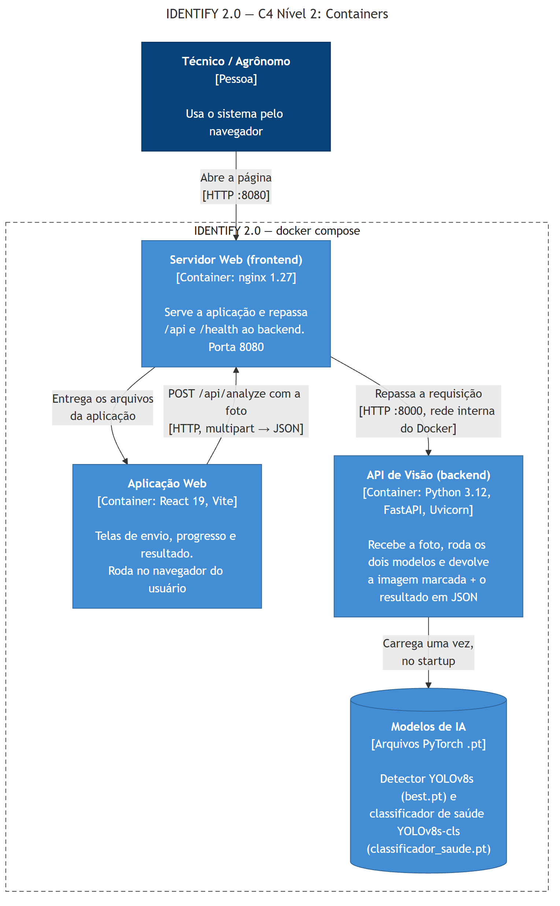

# Operação com Docker — IDENTIFY 2.0

Guia para quem instala, liga e mantém o sistema. Visão geral do projeto no
[README](../README.md); uso da tela no [manual do usuário](manual-do-usuario.md).

O sistema completo (frontend + backend com os dois modelos) em containers.
Um comando sobe tudo; o sistema abre em **http://localhost:8080**.

## Como está montado

O navegador acessa só a porta **8080**. Ali, o container `frontend` (nginx)
entrega a tela e repassa as chamadas `/api/...` ao container `backend`
(FastAPI, com os dois modelos) pela rede interna do Docker:



**Por que dois containers, e não um só:**

- **Tamanhos muito diferentes.** O backend carrega torch + ultralytics + os
  modelos (imagem de ~2,6 GB). O frontend é um site estático (~90 MB). Mudar um
  texto da tela reconstrói só o front, em segundos, sem tocar no backend.
- **Cada um faz uma coisa.** O nginx é feito para servir site e repassar
  requisições; o Python fica só com a inferência.
- **Escala separada.** Se um dia precisar de mais vazão, sobe-se mais um
  backend sem duplicar o front.

**Por que o nginx repassa a API (em vez de o navegador chamar a porta 8000):**
página e API ficam no **mesmo endereço**. Assim não há problema de CORS, e o
sistema funciona igual quando aberto de **outro computador da rede**
(`http://IP-desta-máquina:8080`). Se o front chamasse `localhost:8000` direto,
no computador de outra pessoa esse `localhost` seria a máquina dela.

## Pré-requisito

**Docker Desktop** instalado e aberto (o ícone da baleia na bandeja do Windows).
Para o backend, o Docker precisa de pelo menos ~3 GB de RAM livres para os
containers (em *Settings → Resources*).

## Comandos

Abra um terminal **na raiz do repositório** (nesta máquina,
`C:\Users\Teste\Documents\GitHub\Identify2.0_docker`):

| O que | Comando |
|---|---|
| Subir tudo (o 1º build baixa ~1 GB e demora alguns minutos) | `docker compose up -d --build` |
| Ver se está pronto | `docker compose ps` (o backend fica `healthy` em ~30 s) |
| Abrir o sistema | **http://localhost:8080** (usuário `admin`, senha `admin`) |
| Ver os logs | `docker compose logs -f` (Ctrl+C sai dos logs, não desliga) |
| Desligar | `docker compose down` |
| Ligar de novo (sem rebuild) | `docker compose up -d` |

O frontend só sobe depois que o backend terminou de carregar os modelos, então
quando a página abre, a análise já funciona.

Com `restart: unless-stopped`, os containers voltam sozinhos quando o Docker
Desktop é reaberto, até alguém rodar `docker compose down`.

## Endereços

| Endereço | O que é |
|---|---|
| http://localhost:8080 | o sistema (frontend) |
| http://localhost:8080/health | checa se o backend está no ar, passando pelo nginx |
| http://localhost:8000/docs | documentação interativa da API (só nesta máquina) |
| http://localhost:8000 | página de teste do próprio backend (só nesta máquina) |

A porta 8000 fica aberta só para esta máquina (`127.0.0.1`), para teste e
documentação. Os usuários usam a 8080.

## Configuração

No `docker-compose.yml`, seção `environment` do backend:

| Variável | Padrão | Para que |
|---|---|---|
| `AGAVE_LIMIAR_DOENTE` | `0.5` | a partir de qual `prob_doente` a planta conta como suspeita |
| `AGAVE_MOSTRAR_SADIAS` | `0` | `1` desenha também as plantas sem suspeita |
| `AGAVE_CONF` | `0.30` | limiar do detector (calibrado para a contagem; não mude sem motivo) |

Depois de mudar: `docker compose up -d` (recria o backend; não precisa de build).

**Trocar as portas:** crie um arquivo `.env` nesta pasta com `PORTA=9090`
(sistema) e/ou `PORTA_API=8001` (documentação da API) e rode
`docker compose up -d`.

**Trocar o usuário ou a senha do login:** edite as constantes `USUARIO` e
`SENHA` em `frontend/src/auth.js` e reconstrua o front com
`docker compose up -d --build frontend`. O login é só uma porta de entrada para
a tela (não há cadastro, hash nem token): a API do backend continua aberta.

## O que tem nas pastas

```
Identify2.0_docker/
  README.md              visão geral do projeto
  docker-compose.yml     liga os dois containers
  docs/                  manual, arquitetura (C4), casos de uso, este guia
  backend/               código do identify2.0-backend (branch feature/triagem-saude)
    Dockerfile
    models/              best.pt (detector) e classificador_saude.pt (saúde)
  frontend/              código do identify2.0-frontend/identify-app (mesma branch)
    Dockerfile
    nginx.conf           serve o site e repassa /api ao backend
```

O código aqui é uma **cópia** dos repositórios, tirada do último commit das
branches `feature/triagem-saude`. Os repositórios continuam sendo a fonte:
mudou algo lá e quer refletir aqui, copie de novo (abaixo) e rode
`docker compose up -d --build`.

```powershell
$G = "C:\Users\Teste\Documents\GitHub"
$D = "C:\Users\Teste\Documents\GitHub\Identify2.0_docker"
git -C "$G\identify2.0-backend" archive -o "$env:TEMP\back.tar" HEAD
tar -xf "$env:TEMP\back.tar" -C "$D\backend"
git -C "$G\identify2.0-frontend" archive -o "$env:TEMP\front.tar" HEAD identify-app
tar -xf "$env:TEMP\front.tar" -C "$D\frontend" --strip-components=1
```

(Copia só o que está commitado; os Dockerfiles, o `nginx.conf` e os
`.dockerignore` desta pasta não são sobrescritos.)

## Se algo der errado

- **`ports are not available ... 8000` ou `... 8080`:** outro programa já usa a
  porta, por exemplo um `uvicorn` do backend aberto num terminal. Feche esse
  programa, ou troque a porta no `.env` (seção Configuração).
- **`docker compose ps` não mostra o frontend:** ele espera o backend ficar
  `healthy`. Veja o motivo em `docker compose logs backend`.
- **`error during connect ... dockerDesktopLinuxEngine`:** o Docker Desktop
  não está aberto.

## Testado em 16/11/2026

Build das duas imagens (backend 2,6 GB, frontend 92 MB) e sistema no ar pelo
`docker compose`, testado pelo endereço final (porta 8080, passando pelo nginx):
página, favicon, `/health`, e análise das fotos originais do drone
(12,8 MB): `DJI_0125.JPG` → 244 agaves, 2 suspeitas; `DJI_0081.JPG` → 21 agaves
com o aviso de foto tirada baixo. Acesso pelo IP da máquina na rede local
funcionando; a porta da API não fica exposta na rede. Uso de RAM em repouso:
backend ~600 MB, frontend ~10 MB.

## Limitações conhecidas

- **CPU apenas, e um pouco mais lento que fora do Docker.** Medido nesta
  máquina: ~18 s por foto no container, contra ~13 s rodando direto no
  Windows (o Docker Desktop roda numa máquina virtual). Usar GPU exigiria
  outra imagem base (CUDA) e o suporte a GPU do Docker.
- **O estilo da tela depende de internet.** O front carrega o Tailwind por CDN
  (`index.html`). Sem internet no navegador, a página abre sem formatação.
  Resolver isso é configurar o Tailwind no build do front.
- **Uma análise por vez.** O backend processa uma foto de cada vez (trava
  interna); com vários usuários ao mesmo tempo, as requisições fazem fila.
